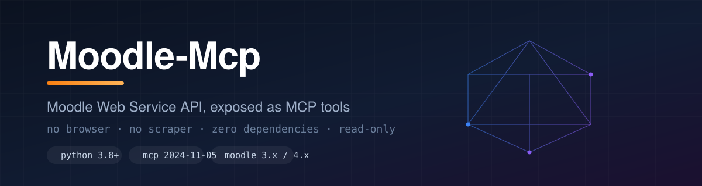
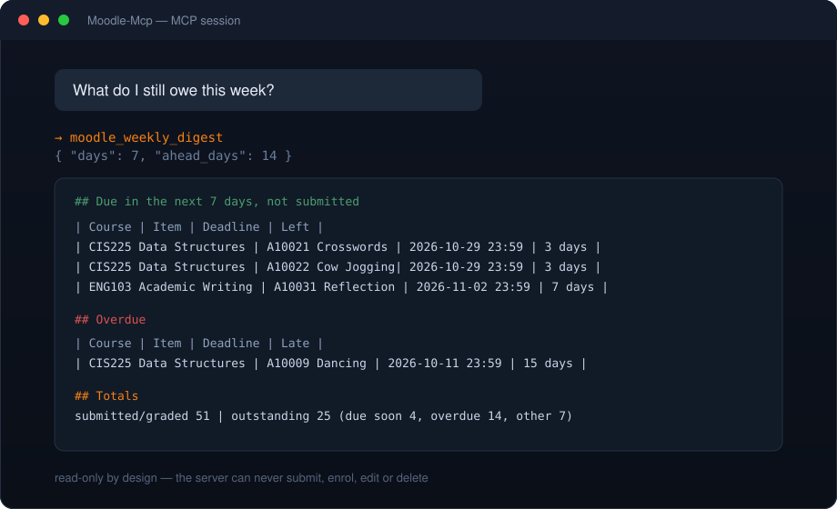

<div align="center">



# moodle-mcp

### Das Moodle, das KI-Agenten wirklich nutzen können

Aufgaben, Fristen und Kursdateien direkt über die Moodle-Web-Service-API lesen. Kein Browser, kein Scraper, keine Klicks.

<a href="LICENSE"></a>


<a href="https://github.com/Faixiang/moodle-mcp/stargazers"></a>

<p>
<a href="README.md">English</a> ·
<a href="README.zh-CN.md">简体中文</a> ·
<a href="README.zh-TW.md">繁體中文</a> ·
<a href="README.ja.md">日本語</a> ·
<a href="README.ko.md">한국어</a> ·
<a href="README.es.md">Español</a> ·
<a href="README.fr.md">Français</a> ·
<b>Deutsch</b> ·
<a href="README.pt-BR.md">Português</a> ·
<a href="README.ru.md">Русский</a>
</p>

</div>

## Vorschau 🖥️



---

## Warum es dieses Projekt gibt 🎯

Moodle betreibt die Lernplattformen von Hochschulen weltweit, hatte aber nie einen allgemeinen MCP-Server. Scraping per Headless-Browser ist langsam, brüchig und läuft regelmäßig in die WAF; dabei bietet Moodle längst eine stabile, dokumentierte REST-API.

Dieses Projekt ist die fehlende Schicht: **eine Python-Datei ohne Abhängigkeiten, sechs reine Lese-Tools**, gültig für jedes Moodle 3.x/4.x mit aktivierten Web Services.

```text
Kein pip install. Kein node. Kein Browser. Nur python server.py.
```

## Funktionen ✨

### Datenabruf
- **Fristen, die man lesen kann** — Aufgaben werden in „bald fällig“, „überfällig“ und „entspannt“ gruppiert, inklusive berechneter Resttage
- **Wochen-Digest** — Neues + bald fällig + überfällig in einem Aufruf, direkt lesbar formatiert
- **Kursdateien** — Abschnittsstruktur und Dateiliste mit Direktlinks und Änderungszeit; nur Metadaten, kein Download
- **Eingebaute Diagnose** — `moodle_site_info` meldet Site-Version, Konto und die Funktionen, die der Token tatsächlich aufrufen darf

### Umsetzung
- **Keine Abhängigkeiten** — ausschließlich Python-Standardbibliothek (`urllib`, `json`, `ssl`)
- **Eine Datei** — `server.py` kopieren und starten; keine Paketstruktur, kein Build-Schritt
- **stdio JSON-RPC 2.0** — direkte Anbindung an Claude Desktop, Cursor, Marvis oder jeden MCP-fähigen Client
- **WAF-freundlich** — Anfragen serialisiert mit 150 ms Abstand, denn Sturmklingeln bei Moodle bringt nur `502`
- **Von Grund auf Nur-Lesen** — es gibt keinen Code zum Abgeben, Belegen, Bearbeiten oder Löschen

## Werkzeuge 🧰

| Werkzeug | Zweck | Parameter |
|---|---|---|
| `moodle_site_info` | Prüft den Token und liefert Site-Name, Moodle-Version, aktuellen Nutzer und die verfügbaren Funktionen (Diagnose). | — |
| `moodle_list_courses` | Listet alle belegten Kurse mit ID, Kurzname und vollständigem Namen. | — |
| `moodle_recent_updates` | Neue oder geänderte Inhalte der letzten N Tage (Aufgaben, Dateien, Ankündigungen), neueste zuerst. | `days` (Standard 7), `course_ids` |
| `moodle_pending_assignments` | Nicht abgegebene Aufgaben, gruppiert in **bald fällig** / **überfällig** / **entspannt**, mit Frist und Resttagen. | `ahead_days` (Standard 14), `course_ids` |
| `moodle_course_files` | Abschnittsstruktur und Dateiliste eines Kurses mit Direktlinks und Änderungszeit. **Nur Metadaten, kein Download.** | `course_id` |
| `moodle_weekly_digest` | Alles in einem Aufruf: Neues + bald fällig + überfällig + Statistik. Empfohlener Einstieg. | `days` (Standard 7), `ahead_days` (Standard 14) |

## Voraussetzungen 📦

| Punkt | Detail |
|---|---|
| Python | 3.8+ (nur Standardbibliothek) |
| MCP-Protokoll | `2024-11-05` |
| Moodle | 3.x / 4.x mit aktivierten Web Services und REST-Protokoll |
| Konto | Mit Berechtigung `webservice/rest:use` |
| Getestete Umgebung | Moodle 4.3.6, Konto mit 435 zugewiesenen Funktionen (volle Rechte) |

## Schnellstart 🚀

### ① Token besorgen

Moodle benötigt einen persönlichen Zugangsschlüssel. Wählen Sie je nach Site:

**A. Web-Oberfläche (empfohlen, auch für SSO-Konten)**

1. Bei Moodle anmelden
2. Profilbild → *Einstellungen* → *Konto* → *Sicherheit* → *Zugangsschlüssel verwalten*
3. „Erstellen“ wählen, Name `moodle-mcp`, Dienst *Moodle mobile web service*
4. Erzeugten Schlüssel kopieren

**B. Per Skript über den Mobile-Dienst (nur wenn die Site ein lokales Passwort führt)**

```bash
python get_token.py
```

Das Skript holt den Token über `/login/token.php` mit dem Dienst `moodle_mobile_app` und prüft ihn sofort. Das Passwort wird weder angezeigt noch protokolliert. Bei reinen SSO-Konten kommt `invalidlogin` zurück — nutzen Sie dann Variante A.

**C. Umgebungsvariablen**

```bash
MOODLE_URL=https://moodle.your-school.edu
MOODLE_TOKEN=your_token_here
```

### ② Konfigurieren

`config.json` neben `server.py` anlegen (oder `config.example.json` kopieren):

```json
{
  "url": "https://moodle.your-school.edu",
  "token": "your_token_here"
}
```

Umgebungsvariablen haben Vorrang vor der Datei.

### ③ Server registrieren

Claude Desktop / Cursor (`mcp.json`):

```json
{
  "mcpServers": {
    "moodle": {
      "command": "python",
      "args": ["/absolute/path/to/moodle-mcp/server.py"]
    }
  }
}
```

In `args` den absoluten Pfad zu `server.py` eintragen. Bei mehreren Python-Versionen `command` auf den vollständigen Interpreter zeigen lassen.

### ④ Prüfen

Im Client `moodle_site_info` aufrufen. Bei korrekter Konfiguration kommen Site-Name, Moodle-Version und Nutzerdaten zurück. Bei Fehlern siehe „Häufige Fragen“.

## Konfigurationsreferenz ⚙️

| Schlüssel | Typ | Pflicht | Beschreibung |
|---|---|---|---|
| `url` / `MOODLE_URL` | String | Ja | Wurzel-URL der Site, ohne Pfad am Ende |
| `token` / `MOODLE_TOKEN` | String | Ja | Persönlicher Token aus „Zugangsschlüssel verwalten“ |
| `config.json` | Datei | Optional | Wird im Verzeichnis von `server.py` gelesen |

Priorität: Umgebungsvariablen → `config.json` → Fehler.

## Anwendungsbeispiele 💬

> „Was ist diese Woche noch offen?“

Der Agent ruft `moodle_weekly_digest` auf und liefert eine direkt lesbare Übersicht:

```text
## In 7 Tagen fällig und nicht abgegeben
| CIS225 Data Structures | A10021 Crosswords  | 2026-10-29 23:59 | 3 Tage |
| CIS225 Data Structures | A10022 Cow Jogging | 2026-10-29 23:59 | 3 Tage |

## Überfällig
| CIS225 Data Structures | A10009 Dancing | 2026-10-11 23:59 | 15 Tage überfällig |

## Statistik
Abgegeben/bewertet: 51 ｜ Offen gesamt: 25 (bald 4, überfällig 14, sonstige 7)
```

Weitere nützliche Anweisungen:

| Sie sagen | Aufgerufenes Werkzeug |
|---|---|
| „Was ist in CIS225 diese Woche neu?“ | `moodle_recent_updates` |
| „Liste die Dateien in GER405, ohne Download“ | `moodle_course_files` |
| „Welche Kurse haben nichts Überfälliges?“ | `moodle_pending_assignments` |
| „Ist mein Token noch gültig?“ | `moodle_site_info` |

## Häufige Fragen 🤔

<details>
<summary><b>get_token.py liefert <code>invalidlogin</code></b></summary>

Ihr Konto läuft ausschließlich über SSO/OIDC und `/login/token.php` hat kein lokales Passwort zum Prüfen. Nutzen Sie Variante A und erzeugen Sie den Token unter „Zugangsschlüssel verwalten“.
</details>

<details>
<summary><b>Aufruf liefert <code>502</code> oder die Verbindung bricht ab</b></summary>

Das ist die Ratenbegrenzung der Site-WAF. Dieser Server serialisiert bereits mit 150 ms Abstand; tritt es dennoch auf, warten Sie einige Minuten und rufen Sie keine mehreren Werkzeuge parallel auf.
</details>

<details>
<summary><b>Das Werkzeug liefert eine leere Liste</b></summary>

Drei Dinge prüfen: Web Services und REST sind aktiv, das Konto hat `webservice/rest:use`, und der Filter `course_ids` stimmt. Rufen Sie zuerst `moodle_site_info` auf — ist die Funktionsliste sehr kurz, hat der Administrator nur die Mobile-Teilmenge freigegeben.
</details>

<details>
<summary><b>Fristen von Turnitin oder Quiz fehlen</b></summary>

Erwartetes Verhalten. `turnitintooltwo` und `quiz` sind eigenständige Module ohne `mod_assign`-Semantik und für diesen Server nicht lesbar. Prüfen Sie es in der Web-Oberfläche.
</details>

<details>
<summary><b>Eine Frist zeigt „not set“</b></summary>

Die Lehrperson hat für diese Aufgabe keine Frist gesetzt, es gibt also nichts zu berechnen. Die Aufgabe bleibt in der Liste, damit sie nicht untergeht.
</details>

<details>
<summary><b>Umlaute im Windows-Terminal sind kaputt</b></summary>

Die Ausgabe ist UTF-8. In alten Konsolen zuerst `chcp 65001` ausführen oder Windows Terminal verwenden.
</details>

## Sicherheit 🔒

- Der Token ist ein **Zugangsdatum**. Nur in `config.json` oder Umgebungsvariablen ablegen, niemals committen; `.gitignore` schließt `config.json` und `get_token.log` bereits aus.
- `get_token.py` protokolliert nicht den Inhalt des Passworts, sondern nur dessen Länge, und liest es über `getpass`.
- Alle Werkzeuge sind reine Leseoperationen. Selbst bei geleaktem Token lässt sich über diesen Server nichts ändern oder löschen. Im Leak-Fall den Schlüssel unter „Zugangsschlüssel verwalten“ widerrufen.
- Keine Traffic-Mitschnitte veröffentlichen: `wstoken` steht im Request-Body.

## Kompatibilität ✅

| Client / Plattform | Status |
|---|---|
| Claude Desktop | Unterstützt (stdio-Servereintrag) |
| Cursor | Unterstützt (`mcp.json`) |
| Marvis | Unterstützt (MCP-Registry) |
| Andere MCP-Clients | Unterstützt — Standard-JSON-RPC 2.0 über stdio |
| Windows / macOS / Linux | Unterstützt — kein plattformspezifischer Code |

## Roadmap 🗺️

- [ ] Turnitin- und Quiz-Fristen im Rahmen der API unterstützen
- [ ] Optionaler lokaler Cache gegen wiederholte Roundtrips bei großen Kurslisten
- [ ] Hinweise zur Seitennummerierung für Konten mit sehr vielen Kursen
- [ ] Details zum Abgabe**status** (bewertet / mit Feedback) — weiterhin nur lesend
- [ ] Dieselbe Werkzeugfläche auf Nicht-Moodle-LMS übertragen

## Mitwirken 🤝

Issues und Pull Requests sind willkommen. Der Server besteht aus einer Datei; `server.py` ist in wenigen Minuten gelesen.

- Keine Abhängigkeiten einführen: nur Standardbibliothek.
- Alle Werkzeuge bleiben reine Leseoperationen.
- Niemals `config.json`, Tokens oder Traffic-Mitschnitte committen.
- Bei neuen Werkzeugen Tabelle und README in **allen Sprachen** aktualisieren.

## Feedback 📢

Fehler und Wünsche: [Issue eröffnen](https://github.com/Faixiang/moodle-mcp/issues).

## Lizenz 📝

MIT — siehe [LICENSE](LICENSE).
